# Sticky architecture: Hermes and Muse

How a voice turn on the reTerminal Sticky gets answered, end to end: the firmware
in this repo, the StickyRelay app on the iPhone, the services on blackbox, and the
two agents behind them. **Hermes** is the self-hosted household agent. **Muse** is
Meta's agent, reached over the Muse gadget protocol.

State as of 2026-10-31, firmware `4ce45ff1` on `main`. Links to `bedej/homelab`
point at a private repo.

- [1. The whole system](#1-the-whole-system)
- [2. Components](#2-components)
- [3. Choosing a transport](#3-choosing-a-transport)
- [4. A Hermes turn over Wi-Fi](#4-a-hermes-turn-over-wi-fi)
- [5. A Muse turn over Bluetooth](#5-a-muse-turn-over-bluetooth)
- [6. Sticky firmware](#6-sticky-firmware)
- [7. iOS sidecar: StickyRelay](#7-ios-sidecar-stickyrelay)
- [8. The BLE contract](#8-the-ble-contract)
- [9. blackbox services](#9-blackbox-services)
- [10. The Muse leg](#10-the-muse-leg)
- [11. Conversations and the agent toggle](#11-conversations-and-the-agent-toggle)
- [12. Other Muse pieces](#12-other-muse-pieces)
- [13. Credentials and trust boundaries](#13-credentials-and-trust-boundaries)
- [14. Wire reference: `/v1/stream`](#14-wire-reference-v1stream)
- [15. Observability and debugging](#15-observability-and-debugging)
- [16. Open work](#16-open-work)
- [17. Source map](#17-source-map)

## 1. The whole system

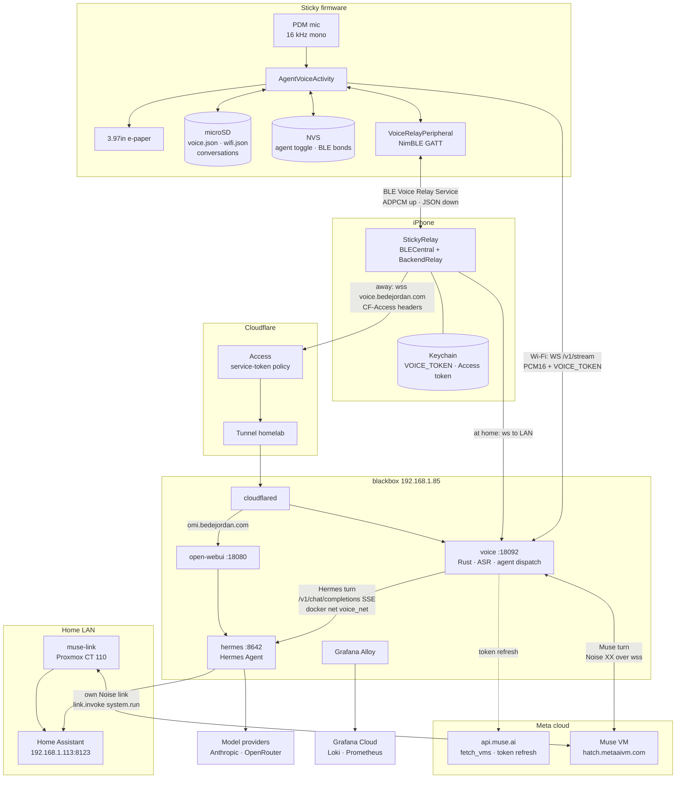

The Sticky never talks to an agent. Every turn goes to the `voice` service on
blackbox, which runs speech recognition and hands the final transcript to the agent
the turn names. The Sticky has no speaker, so answers come back as text on the
e-paper.

Audio reaches `voice` one of two ways:

- **Wi-Fi** (at home). The Sticky opens a WebSocket straight to blackbox.
- **Bluetooth** (anywhere). The Sticky streams to StickyRelay on the iPhone, which
  opens the WebSocket itself: to the LAN address when it answers, otherwise through
  Cloudflare.

Which agent answers is a setting on the Sticky, sent with every turn. Everything
before the agent leg (mic, transports, phone relay, ASR) is the same for both.

## 2. Components

| Component | Runs on | Source | Job |
|---|---|---|---|
| Sticky firmware | reTerminal Sticky: ESP32-S3, 16 MB flash, 8 MB PSRAM, 3.97" SSD1677 e-paper, touch, PDM mic, microSD, battery | this repo, `pio run -e sticky` | Push-to-talk capture, transport choice, transcript rendering and storage, agent toggle |
| StickyRelay | iPhone, iOS 17+ | [`phone-relay/ios`](https://github.com/bedej/homelab/tree/main/projects/assistant/phone-relay/ios) | BLE central; decodes audio, relays it to `voice`, forwards every reply to the Sticky |
| mock-sticky | Mac | [`phone-relay/mac-peripheral`](https://github.com/bedej/homelab/tree/main/projects/assistant/phone-relay/mac-peripheral) | Plays the Sticky's GATT service so the app can be tested without the device |
| `voice` | blackbox, Docker, `/opt/apps/voice` | [`voice`](https://github.com/bedej/homelab/tree/main/projects/assistant/voice) (Rust) | Audio in, streaming and refined ASR, agent dispatch, streamed answers out, latency metrics |
| Hermes + Open WebUI | blackbox, Docker, `/opt/apps/hermes` | [`hermes`](https://github.com/bedej/homelab/tree/main/projects/assistant/hermes) | The household agent: memory, tools, cron, Home Assistant. Open WebUI is its chat UI at omi.bedejordan.com |
| cloudflared | blackbox, systemd | [`cloudflare-tunnel.nix`](https://github.com/bedej/homelab/blob/main/infrastructure/blackbox/cloudflare-tunnel.nix), [`routes.json`](https://github.com/bedej/homelab/blob/main/infrastructure/blackbox/routes.json) | Outbound-only tunnel that publishes `voice` and Open WebUI |
| Cloudflare Access | Cloudflare edge | dashboard | Service-token gate on voice.bedejordan.com; SSO gate on omi |
| Muse VM | Meta cloud | none (protocol from [`muse-gadget-sdk`](https://github.com/facebookincubator/muse-gadget-sdk)) | The Muse agent. `voice` reaches it as a paired gadget |
| muse-link | Proxmox LXC, CT 110 | [`muse-link`](https://github.com/bedej/homelab/tree/main/projects/assistant/muse-link) | A separate Muse gadget that lets Muse run commands on the LAN. Not in the voice path |
| Home Assistant | LAN | none | Reached by Hermes's native adapter, and by Muse through muse-link |
| sticky-harness | Mac | [`sticky-harness`](https://github.com/bedej/homelab/tree/main/projects/assistant/sticky-harness) | Serial and WebSocket scripts for testing without touch or a room |

## 3. Choosing a transport

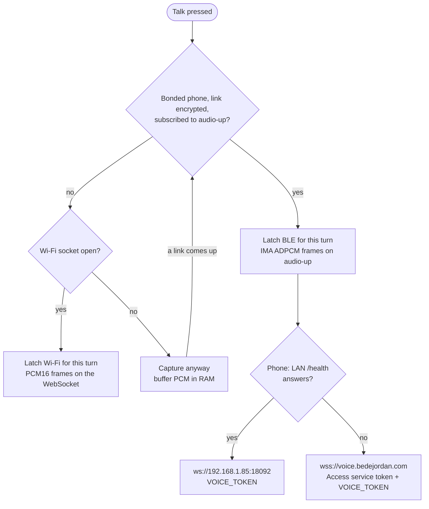

- The firmware chooses per turn and latches the choice when capture starts
  (`AgentVoiceActivity::chooseTransport`). Bluetooth wins whenever a bonded phone
  is subscribed. Audio buffered for one transport is never drained down the other.
- With no link up, capture starts anyway. PCM is buffered and drained in order once
  a link opens, so the user can talk straight away.
- The phone probes the LAN endpoint's `/health` first, then the public hostname,
  and keeps whichever answered. The app shows "home" or "remote".
- During a Bluetooth turn the Sticky's own Wi-Fi socket may still be open and idle,
  so `voice` sees two sessions. `?client=sticky` and `?client=phone-relay` tell them
  apart in the logs.
- The status bar shows the transport glyph: the latched one during a turn, and at
  rest the one that would carry the next turn.

## 4. A Hermes turn over Wi-Fi

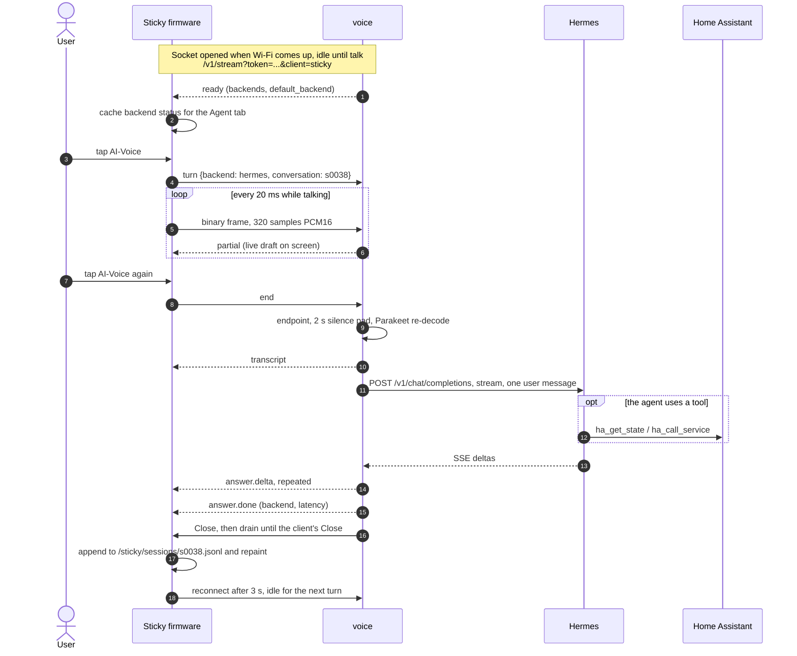

- One socket per turn. After `answer.done` the server sends Close and keeps reading
  until the client's Close (2 s cap), so the tail of the answer is never cut off.
  The firmware's WebSocket client reconnects 3 s later.
- Hermes gets the final transcript as a single user message, with no earlier turns
  from the conversation (HomeLab-14y). Hermes's own long-term memory still applies.
- Hermes reaches Home Assistant through its native adapter (`HASS_URL` /
  `HASS_TOKEN`), and model providers directly.
- Measured: Hermes time to first token about 1.3 s on a short question.

## 5. A Muse turn over Bluetooth

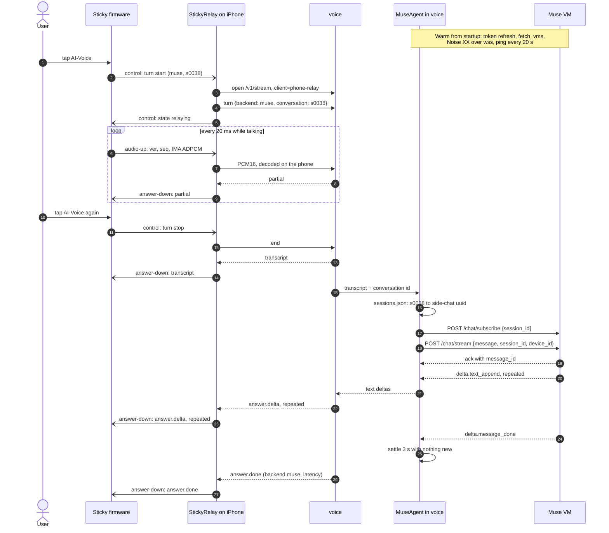

- Verified end to end over Bluetooth on 2026-10-04 (homelab `fbb3d93`,
  conversation `s0027`). Over Wi-Fi the Sticky sends the same `turn` frame itself.
- The phone must send the `turn` frame before any audio. Before `fbb3d93` it
  dropped the device's choice, and Muse turns over Bluetooth were silently answered
  by Hermes while the screen showed **M**.
- Text reaches the screen as it streams. Only `answer.done` waits for the settle.
- Measured: a new side chat takes about 8 s to first text; a follow-up in the same
  chat about 2.5 to 3 s.
- A Muse failure arrives as `error` (for example `Muse: not paired`), then
  `answer.done`. There is no fallback to Hermes.

## 6. Sticky firmware

This repo is a fork of the CrossPoint e-reader firmware, running on the FreeInk SDK
hardware layer (`freeink-sdk/`). Voice is one screen in the reader, launched from
the home menu's **Voice Assistant** item. Build with pioarduino PlatformIO Core
6.1.19, `env:sticky` (see [BUILD.md](BUILD.md)). Libraries for voice:
`links2004/WebSockets` 2.7.3 and `h2zero/NimBLE-Arduino` 2.3.x.

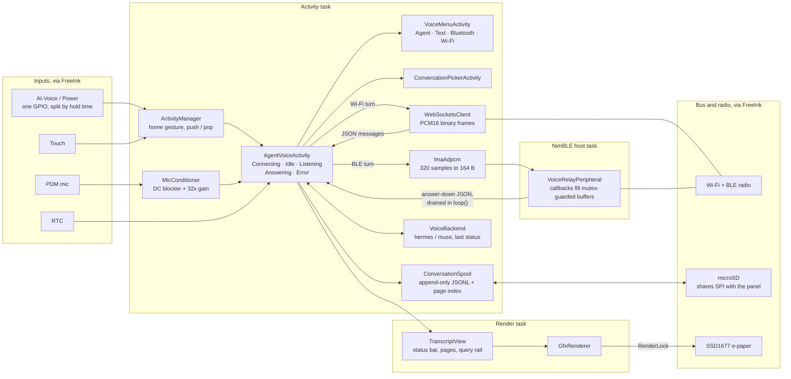

**What lives where**

| Where | What | Written by |
|---|---|---|
| SD `/.crosspoint/voice.json` | `token`, `host`, `port` for `voice` (defaults `192.168.1.85:18092`) | The user. The firmware only reads it |
| SD `/.crosspoint/wifi.json` | Saved Wi-Fi networks | Wi-Fi screens |
| SD `/sticky/sessions/<id>.jsonl` | One conversation, append-only: `u` user turn, `a` agent chunk, `m` metadata such as the backend | ConversationSpool |
| SD `/sticky/sessions/<id>.idx` | Page and turn index, valid for one render spec (font, size, gap, cue) | ConversationSpool |
| SD `/sticky/sessions/current` | The open conversation | ConversationSpool |
| SD `/crash_report.txt` | Last panic, shown by CrashActivity on boot | Panic handler |
| NVS | Agent toggle; BLE bond keys and the pairing marker | VoiceBackend, NimBLE |
| Flash | `app0` / `app1` OTA slots (6.25 MB each), `spiffs`, `coredump` | Flasher, OTA, panic |

**Behaviour that shapes the design**

- AI-Voice and Power share a GPIO. In the voice screen a tap is talk and a 1.5 s
  hold is sleep, so a long press cannot sleep the device mid-conversation.
- Deep sleep wakes by reset, so RAM is gone. The spool on SD is the source of
  truth, every page is laid out again from it, and boot returns to the voice screen
  if it slept there.
- Agent replies are appended chunk by chunk as they stream, so a sleep or crash
  mid-reply loses at most the last delta.
- A conversation whose last turn is more than 4 h old rotates to a new one when the
  voice screen opens.
- SD, NVS and the e-paper share bus timing. Anything that touches SD or NVS from a
  render path takes the `RenderLock`, and the agent toggle is cached and written
  only on change.
- The status bar always shows **H** or **M** next to the transport glyph.
- Errors show as a short reason on the status line, held through the
  `answer.done` that follows.

Controls and gestures are in [VOICE.md](VOICE.md#controls).

## 7. iOS sidecar: StickyRelay

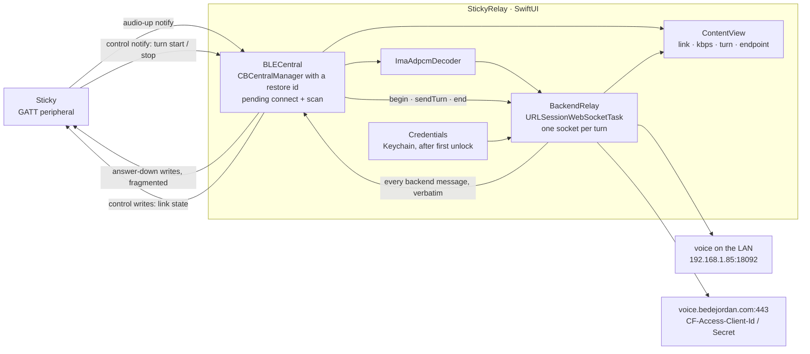

- **Background.** The `bluetooth-central` background mode and
  `CBCentralManagerOptionRestoreIdentifierKey` let iOS relaunch the app for BLE
  events, so a locked phone in a pocket carries a turn. Verified by killing the app:
  iOS relaunched it and relaying resumed.
- **Reconnect.** A pending `connect` to the known peripheral, plus a scan.
  Background scans are throttled and match only service UUIDs in the advertisement
  packet.
- **Pairing.** The app reads `audio-up` after discovery. The read fails with
  insufficient authentication, and that is what makes iOS pair (section 8).
- **Turns.** One backend socket per turn, opened on the device's turn start. The
  `turn` frame goes before any audio.
- **Replies.** Every backend message is forwarded verbatim over `answer-down`, so
  the firmware parses Wi-Fi and Bluetooth turns with the same `handleMessage`.
- **Counters.** Sent, dropped and failed counts go back to the device, since a
  phone in a pocket has no log anyone can read.
- **Secrets.** `VOICE_TOKEN` and the Access service token live in the Keychain.
  `run-on-device.sh` can seed them once from build settings; after that the Keychain
  copy wins.
- **Build.** XcodeGen from `project.yml`; the `.xcodeproj` is generated. BLE does
  not work in the Simulator, so every real test needs a physical iPhone.
- **Link budget.** 64 kbps of ADPCM needed. Measured 125 to 146 kbps foreground,
  82 to 123 backgrounded, 130 to 160 locked, ATT MTU 515.

## 8. The BLE contract

Full spec: [`VoiceRelayProtocol.md`](https://github.com/bedej/homelab/blob/main/projects/assistant/phone-relay/VoiceRelayProtocol.md).
The Sticky is the **peripheral** because only a central can be relaunched by iOS to
service a connection it initiated.

| Characteristic | UUID | Properties | Carries |
|---|---|---|---|
| Voice Relay Service | `3CB420D1-7509-4199-A48C-0A1A58CC0E33` | in the advertisement packet | |
| `audio-up` | `727BBFAC-27E4-4FA8-BFE1-CE5EBB638761` | Notify, Read (encrypted) | Device to phone: `ver` u8, `seq` u16 LE, then IMA ADPCM with its own 4-byte state header |
| `control` | `875FCF17-3C92-41AB-8019-4F68F0ABAB49` | Write, Write without response, Notify | Phone to device: `start`, `stop`, `state`. Device to phone: `ready`, `turn` (with `backend` and `conversation`), `error` |
| `answer-down` | `A684CBCC-ED6F-4E9F-94F0-E0254BA8FB42` | Write, Write without response | Phone to device: backend JSON, each write prefixed `0x00` (more follows) or `0x01` (last fragment) |

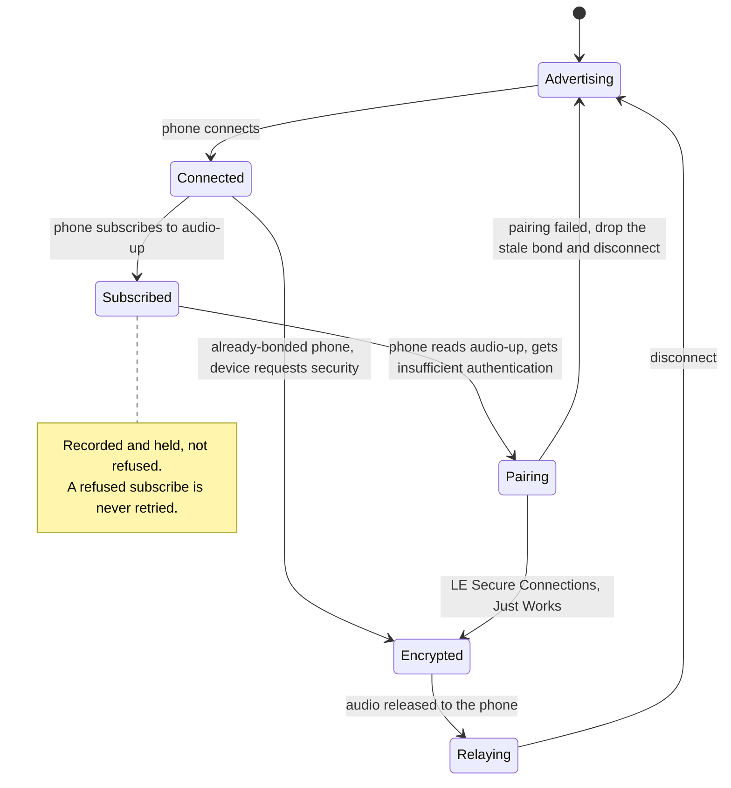

- Relaying needs a central that is bonded **and** encrypted. A new phone can bond
  only while the pairing window is open (Voice menu, Bluetooth tab).
- Pairing gates on an NVS marker, not the NimBLE bond count: this device holds a
  bond record that neither delete call removes.
- Forgetting is two-sided and iOS has no API to drop a bond. If a link will not
  encrypt, forget "Sticky" in iOS Settings > Bluetooth.

## 9. blackbox services

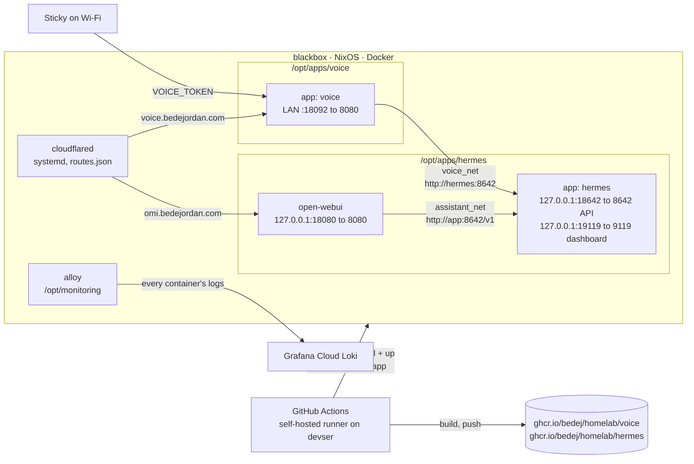

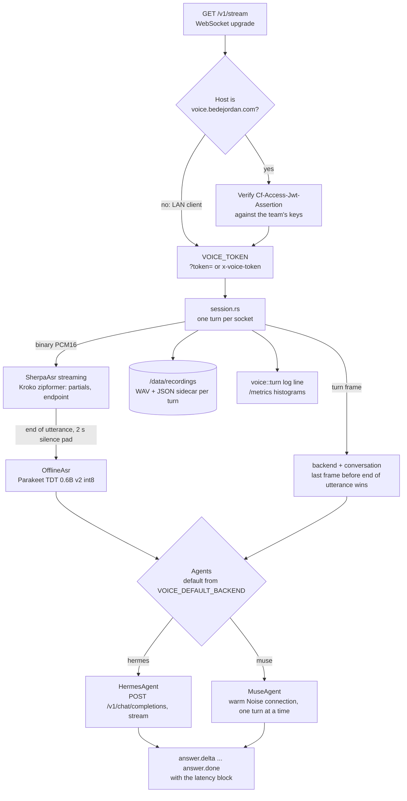

**voice** (Rust, axum). Routes: `/v1/stream` (the session), `/health` (never
authenticated; CI gate and Docker healthcheck), `/metrics`, `/recordings`.

- **ASR, two passes.** The streaming Kroko zipformer gives live partials and finds
  the end of the utterance; 2 s of silence is fed before finishing so the last word
  decodes. The offline Parakeet model then re-decodes the whole utterance (about
  0.4 s for a 6 s turn), and its text is the transcript the agent sees. Both models
  are baked into the image.
- **Muse's own speech-to-text was tried and not used.** Live dictation is closed to
  gadget tokens (403), and voice notes give no live partials.
- **An empty transcript** never reaches an agent; the device gets "I didn't catch
  that".
- **Agents** sit behind one trait (`agent.rs`), so the device's message handling is
  the same for both. `ready.backends` reports each one as `ready`, `connecting`,
  `unpaired` or `error`.

**Hermes** (Hermes Agent, pinned image, s6 as PID 1) runs as `app` with Open WebUI
beside it. Its state, including `config.yaml`, `SOUL.md`, memory, skills, channels and
cron, lives in `data/hermes/` and is edited from the dashboard, not by CI.

**Ports and exposure**

| Host port | Service | Reachable from |
|---|---|---|
| `:18092` (LAN bind) | `voice` | The Sticky on the LAN; the world as voice.bedejordan.com through the tunnel and Access |
| `127.0.0.1:18642` | Hermes `/v1`, `/health` | `voice` over `voice_net`, Open WebUI over `assistant_net` |
| `127.0.0.1:19119` | Hermes dashboard | SSH tunnel only |
| `127.0.0.1:18080` | Open WebUI | omi.bedejordan.com through the tunnel and Access SSO |

**Deploy.** A push to `main` under a project directory builds its image on the
self-hosted runner (build context is the project's parent), pushes it to GHCR, and
deploys over SSH to `/opt/apps/<name>`. The gate checks the `app` service's
healthcheck. The NixOS host itself, including cloudflared, deploys with
`scripts/deploy-blackbox.sh`.

## 10. The Muse leg

`voice/src/muse/` is a Rust port of the gadget SDK's chat path: the Python Linux
SDK for Noise and framing, and the ESP32 firmware's `muse_chat_session.cpp` for
reading replies. Full plan: [`MUSE_BACKEND_PLAN.md`](https://github.com/bedej/homelab/blob/main/projects/assistant/MUSE_BACKEND_PLAN.md);
what the API allows: [`MUSE_CHAT_API.md`](https://github.com/bedej/homelab/blob/main/projects/assistant/MUSE_CHAT_API.md).

| File | Does |
|---|---|
| `account.rs` | `GET /fetch_vms` and `POST /device_token/refresh` on `api.muse.ai`; refresh when the token is 3 h old or on a 401; atomic `pairing.json` rewrite |
| `proto.rs` | Noise transport frames and the request / response / body envelope, byte-identical to the SDK's Python encoder |
| `conn.rs` | `wss://hatch.metaaivm.com/v1/noise?vm_id=...` with the VM bearer; `Noise_XX_25519_AESGCM_SHA256` via `snow`; stream multiplexer; ping every 20 s, dead after 60 s |
| `chat.rs` | Holds `/chat/subscribe` per side chat, posts to `/chat/stream`, binds the reply to the turn, keeps `sessions.json` |
| `mod.rs` | `MuseAgent`: warm-connection supervisor, status, one turn at a time |

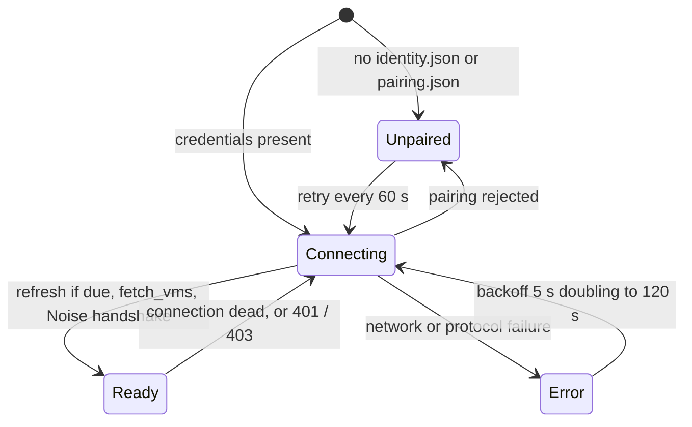

**Binding a reply to a turn.** Muse never links a reply to its question, so:

1. Each Sticky conversation maps to its own Muse **side chat** (`sessions.json`:
   conversation id to a random uuid; a turn with no id uses `sticky-default`).
   Side chats keep Sticky traffic out of the main Muse chat, and each has its own
   memory.
2. For an existing chat, open the feed `/chat/subscribe {"session_id": X}` before
   posting. A new chat does not exist until the first post, so its feed opens right
   after the ack.
3. Post with `x-app-id: hatch-web`, `output_modality: text` and `device_id`, which
   tags both the message and the reply.
4. The reply is the assistant message in X whose `message_seq` is ours plus one,
   checked against `chat_context.device_id`. Each `delta.text_append` becomes an
   `answer.delta`.
5. The turn ends at `delta.message_done` plus 3 s of quiet (`MUSE_SETTLE_MS`), held
   up to 20 s more while Muse reports itself busy. Caps: 60 s to the first reply,
   180 s overall.

No `link.register` is sent, and device tokens get no history API, so the Sticky's
spool is the only copy of a Muse conversation the device can show.

**Credentials.** The chat client was paired once as a Linux gadget, in a throwaway
container on blackbox, with the stock daemon never installed. `identity.json` and
`pairing.json` sit in `/opt/apps/voice/data/muse` (0600, the container user), and
`voice` is their only holder, because two processes refreshing one token pair rotate
each other out. `MUSE_SDK_TOKEN` in `.env` goes with each refresh.

## 11. Conversations and the agent toggle

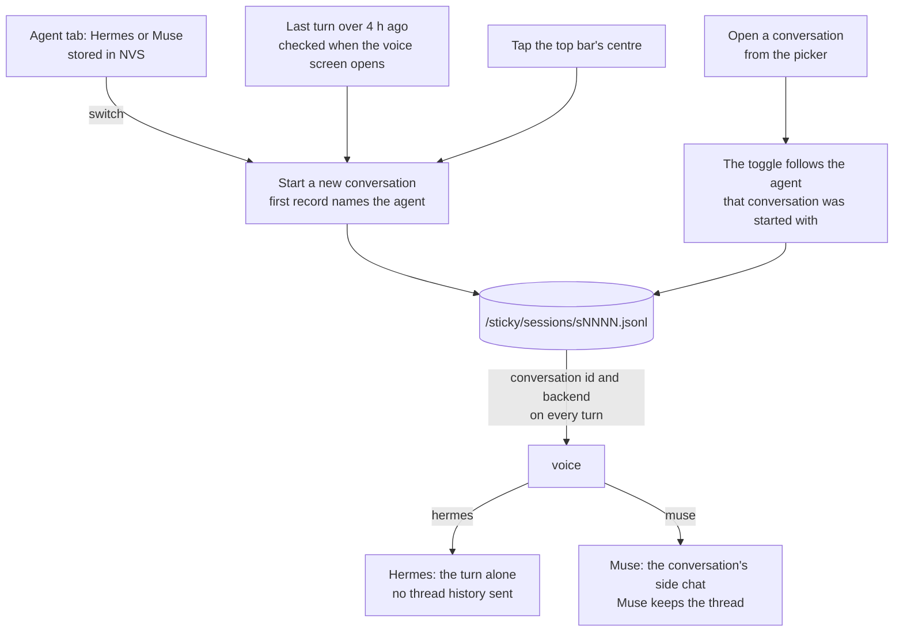

- Hermes and Muse do not share context, so a conversation belongs to one agent.
  Switching agent starts a new conversation, and opening an old one switches the
  agent back to the one it was started with.
- The picker marks each conversation **H** or **M**.
- The default agent is Hermes: Muse turns leave the LAN, so choosing Muse is
  explicit and the **M** stays on screen.

## 12. Other Muse pieces

Neither of these is in the Sticky's voice path. They are here so the names don't
get confused.

| | What | Relation to the Sticky |
|---|---|---|
| **muse-link** | The stock Muse Linux gadget in a container on its own unprivileged LXC (CT 110). Muse calls it over its own Noise link (`link.invoke system.run`, `file.read`, `file.write`) to run commands on the LAN as the unprivileged `muse` user, including Home Assistant through an `ha` helper. Every command is logged. Its own pairing and SDK token | None directly. A Muse turn from the Sticky can end up using it if Muse decides to act on the house |
| **Upstream Sticky firmware** | `muse-gadget-sdk` ships experimental `reterminal-sticky` and `reterminal-sticky-link` ESP32 profiles, where the Sticky itself is the Muse gadget and talks to the VM directly | An alternative to this firmware, not a part of it. Flashing it replaces CrossPoint and the Hermes path entirely |

## 13. Credentials and trust boundaries

| Secret | Lives | Used for |
|---|---|---|
| `VOICE_TOKEN` | blackbox `/opt/apps/voice/.env`; Sticky SD `/.crosspoint/voice.json`; iPhone Keychain | WebSocket handshake to `voice` |
| Access service token | iPhone Keychain only | Passing Cloudflare Access on voice.bedejordan.com |
| Tunnel credentials | blackbox `/var/lib/cloudflared` | cloudflared |
| `API_SERVER_KEY` (`HERMES_API_KEY` in voice) | hermes and voice `.env` | `voice` and Open WebUI to Hermes |
| Muse pairing (`identity.json`, `pairing.json`) and `MUSE_SDK_TOKEN` | `/opt/apps/voice/data/muse`, voice `.env` | MuseAgent |
| muse-link pairing, SDK token, HA token | CT 110 | muse-link only, never shared with voice |
| HA token | hermes `.env` | Hermes's Home Assistant adapter |
| BLE bond keys | Sticky NVS; iPhone | Link encryption |

Layers on the public endpoint, none trusted alone:

| Layer | Stops |
|---|---|
| Tunnel, outbound only | Direct attack on blackbox: no inbound ports, origin IP hidden |
| Access service token at the edge | Unauthenticated traffic, before it reaches the origin |
| JWT check at the origin, scoped by `Host` | A request that got past a misconfigured or deleted Access policy |
| `VOICE_TOKEN` | Anyone with an Access token but not the app secret |

The Sticky never gets the public endpoint or the Access token. A stolen Sticky
yields a token that works only inside the house.

Both agents can act on the house. Test phrases must be questions, never commands:
replayed clips have turned real lights on and off.

## 14. Wire reference: `/v1/stream`

| Direction | Message | Notes |
|---|---|---|
| client to server | binary frame | PCM16 LE, mono, 16 kHz, 20 ms (320 samples) |
| client to server | `{"type":"turn","backend":"hermes"\|"muse","conversation":"s0038"}` | The last one before end of utterance wins. Missing or unknown backend falls back to `VOICE_DEFAULT_BACKEND` |
| client to server | `{"type":"end"}` | End of utterance. Closing the socket also ends it |
| server to client | `ready` | `engine`, `sample_rate`, `backends` per agent, `default_backend` |
| server to client | `partial` | Live ASR text, revised in place |
| server to client | `transcript` | Final, refined text |
| server to client | `answer.delta` | Streamed answer text; the device collates |
| server to client | `answer.done` | `backend`, `latency` (`agent_ttft_ms` always, `hermes_ttft_ms` on Hermes turns) |
| server to client | `error` | Short, user-facing reason, followed by `answer.done` |

Query parameters: `token` (or header `x-voice-token`), `client` (`sticky` or
`phone-relay`, for the logs).

## 15. Observability and debugging

| Where | What |
|---|---|
| `voice` logs | One `voice::turn` line per turn with every latency stage, backend and conversation. Alloy ships all container logs to Grafana Cloud Loki: `{project="voice"}` |
| `voice` `/metrics` | Histograms per stage (`voice_first_partial_ms`, `voice_asr_decode_ms`, `voice_hermes_ttft_ms`, `voice_end_to_end_ms`, ...). No scrape block in `alloy-config.alloy` yet |
| `voice` `/recordings` | Every turn's WAV with a JSON sidecar, playable in the browser |
| `answer.done.latency` | The same stage timings, on the device |
| Hermes | Dashboard at `127.0.0.1:19119` over SSH; `docker compose logs app` |
| iPhone | `os.Logger` subsystem `com.bedej.sticky.relay`; turn counters echoed to the device |
| Sticky serial | `CMD:` hooks over the CH343 USB bridge (`CMD:PTT`, `CMD:VMENU`, `CMD:BLESTATE`, `CMD:BACKEND`, `CMD:SCREENSHOT`, `CMD:CRASH`, `CMD:DOWNLOAD`, ...). Opening the port resets the board |
| Sticky crashes | `/crash_report.txt` on SD and the `coredump` partition. Keep the ELF from every flash to decode a panic, and read the version with `strings firmware.elf`, not the build time |
| sticky-harness | `wsturn.py` and `voiceturn.py` (a WAV through `/v1/stream`), `transcriptturn.py`, `micrec.py`, `serlog.py`, `fontsweep.py` |

`CMD:SCREENSHOT` reads the framebuffer, not the panel, so it can show a frame the
e-paper never displayed.

## 16. Open work

From the homelab tracker, label `sticky`, on 2026-10-31:

- **HomeLab-14y**: Hermes sees each turn alone, with no conversation history.
- **HomeLab-s2o**: soak both agents for a week (stuck turns, Muse reconnects, time to
  first token for both in Grafana). Depends on the `voice` metrics being scraped.
- **HomeLab-701**: localize the voice screen's strings through `tr()`.
- **HomeLab-4gl** and **HomeLab-36j** are still open, although the Muse-over-Bluetooth
  turn they describe was verified on 2026-10-04.

## 17. Source map

| Area | Files |
|---|---|
| Voice screen | [`src/activities/network/AgentVoiceActivity.{h,cpp}`](src/activities/network/AgentVoiceActivity.h) |
| Voice menu | [`src/activities/settings/VoiceMenuActivity.{h,cpp}`](src/activities/settings/VoiceMenuActivity.h) |
| Conversations | [`src/activities/transcript/`](src/activities/transcript/): `ConversationSpool`, `TranscriptView`, `ConversationPickerActivity` |
| BLE peripheral | [`src/ble/VoiceRelayPeripheral.{h,cpp}`](src/ble/VoiceRelayPeripheral.h) |
| Agent toggle | [`src/voice/VoiceBackend.{h,cpp}`](src/voice/VoiceBackend.h) |
| Audio | [`src/audio/`](src/audio/): `ImaAdpcm`, `MicConditioner` |
| Firmware docs | [VOICE.md](VOICE.md), [BUILD.md](BUILD.md) |
| iOS app | [`phone-relay/ios/Sources/`](https://github.com/bedej/homelab/tree/main/projects/assistant/phone-relay/ios/Sources): `BLECentral`, `BackendRelay`, `Credentials`, `VoiceRelayProtocol`, `ContentView` |
| voice service | [`voice/src/`](https://github.com/bedej/homelab/tree/main/projects/assistant/voice/src): `session`, `sherpa`, `offline`, `agent`, `hermes`, `access`, `metrics`, `muse/` |
| Hermes | [`hermes/compose.yml`](https://github.com/bedej/homelab/blob/main/projects/assistant/hermes/compose.yml), [`assistant/README.md`](https://github.com/bedej/homelab/blob/main/projects/assistant/README.md) |
| Design docs | [`MUSE_BACKEND_PLAN.md`](https://github.com/bedej/homelab/blob/main/projects/assistant/MUSE_BACKEND_PLAN.md), [`MUSE_CHAT_API.md`](https://github.com/bedej/homelab/blob/main/projects/assistant/MUSE_CHAT_API.md), [`REMOTE_ACCESS.md`](https://github.com/bedej/homelab/blob/main/projects/assistant/REMOTE_ACCESS.md), [`STICKY_BLE_ROAMING.md`](https://github.com/bedej/homelab/blob/main/projects/assistant/STICKY_BLE_ROAMING.md), [`VoiceRelayProtocol.md`](https://github.com/bedej/homelab/blob/main/projects/assistant/phone-relay/VoiceRelayProtocol.md) |
| blackbox | [`infrastructure/blackbox/`](https://github.com/bedej/homelab/tree/main/infrastructure/blackbox): `configuration.nix`, `cloudflare-tunnel.nix`, `routes.json` |
